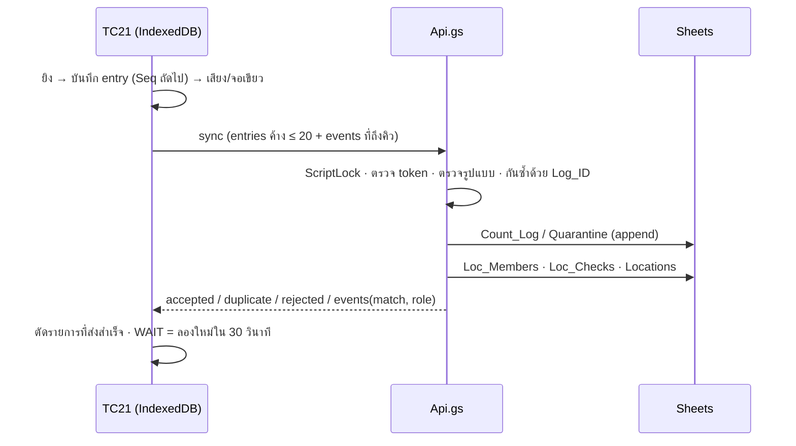

# API ของเครื่อง TC21 (API_VERSION 2 · v2.2.2)

Web app ของ Apps Script (`gas/Api.gs`) Deploy แบบ **Execute as: Me · Who has access: Anyone**
URL ลงท้าย `/exec` ตั้งไว้ใน `app/config.json` (`apiUrl`) และชีต Config (`API_URL`)
การเข้าถึงไม่ได้พึ่งการซ่อน URL: ทุก action ยกเว้น `ping` และ `pair` ต้องมี device token

## รูปแบบคำขอ

- `POST` เนื้อหาเป็น JSON ส่งด้วย `Content-Type: text/plain` (เลี่ยง CORS preflight ซึ่ง Apps Script ไม่รองรับ)
- ทุกคำขอมี `action` และ (ยกเว้น ping/pair) `deviceId`, `token`, `appVersion`

```json
{ "action": "sync", "deviceId": "TC21-01", "token": "<64 ตัวอักษร>", "appVersion": "2.2.0", "entries": [], "events": [] }
```

- ทุกคำตอบมี `ok`, `serverTime` (ms), `serverVersion` (เช่น `2.2.0`)
- ผิดพลาด: `{ "ok": false, "error": "<CODE>", "message": "<ข้อความภาษาไทย>" }`

`GET ?action=ping` → `{ ok, serverTime, api, serverVersion }` (ใช้ปุ่มทดสอบในหน้า Admin)

## สรุป action

| action | ต้องมี token | ใช้ตอนไหน | เขียนข้อมูล |
|---|---|---|---|
| `ping` | ไม่ | ทดสอบการเชื่อมต่อ | — |
| `pair` | ไม่ (ใช้รหัสจับคู่) | ตั้งเครื่องครั้งแรก / จับคู่ใหม่ | Devices, Admin_Log |
| `bootstrap` | ใช่ | เปิดแอป / ตรวจความพร้อม | Devices (Last_Sync) |
| `master` | ใช่ | โหลดรายการบาร์โค้ดที่อนุมัติ | — |
| `stock` | ใช่ | โหลดยอดบัญชีต่อสินค้า (แสดงในช่อง SKU) | — |
| `sync` | ใช่ | ส่งรายการนับและเหตุการณ์ Location ทุก 2–3 วินาทีเมื่อมีของค้าง | Count_Log, Quarantine, Locations, Loc_Members, Loc_Checks, Devices |
| `locInfo` | ใช่ | เปิด Location / ดูยอดรวม / ก่อนแก้ยอดหรือปิด | Loc_Members (ย้ายข้อมูลครั้งแรก) |
| `myLocs` | ใช่ | หน้า Location ที่นับแล้ว / หลังจับคู่ใหม่ | — |
| `check` | ใช่ | ส่งผลตรวจความพร้อม | Device_Checks, Devices |
| `hello` | ใช่ | รายงานตัวทุก 1 นาที (v2.2.2) | CacheService เท่านั้น (ไม่เขียนชีต) |
| `unpair` | ใช่ | ผู้ใช้กด "ยกเลิกการจับคู่เครื่องนี้" (v2.2.2) | Devices (ล้าง token), Admin_Log |
| `locStatus` | ใช่ | แอปรุ่นก่อน 2.2.0 (เก็บไว้ให้เข้ากันได้) | — |

---

## pair
คำขอ: `{ action, deviceId, code, appVersion }` — `code` = รหัส 6 หลักจากหน้า Admin (อายุ 30 นาที)

คำตอบ: `{ ok, deviceId, token, deviceName, maxSeqAll }`
- `token` ส่งครั้งเดียว เซิร์ฟเวอร์เก็บเฉพาะ SHA-256 · token เดิมของเครื่องใช้ไม่ได้ทันที
- `maxSeqAll` = Seq สูงสุดที่เซิร์ฟเวอร์เคยได้รับจากเครื่องนี้ (ทุกรอบ) เครื่องต้องเริ่ม Seq ต่อจากเลขนี้

ข้อผิดพลาด: `UNKNOWN_DEVICE` · `DEVICE_DISABLED` · `NO_PAIR_CODE` (ไม่มี/หมดอายุ) · `BAD_PAIR_CODE` (ผิดครบ 5 ครั้ง รหัสถูกยกเลิก)

## bootstrap
คำตอบ:
```json
{
  "ok": true,
  "project": { "id": "2026Q4", "countDate": "2026-11-04", "status": "COUNTING" },
  "master": { "approved": true, "hash": "<checksum>", "version": 3, "count": 2330 },
  "staff": [{ "code": "EMP-X", "name": "…", "role": "…" }],
  "stockVersion": "<SAP_UPLOADED_AT>|<POS_UPLOADED_AT>",
  "device": { "id": "TC21-01", "name": "…", "maxSeq": 120, "received": 120, "gaps": [], "maxSeqAll": 120 }
}
```
`master.approved` เป็น false เมื่อ Master ที่อนุมัติไม่ใช่ของรอบนี้ หรือข้อมูลเปลี่ยนหลังอนุมัติ

## master
คำตอบ: `{ ok, projectId, hash, version, rows: [[barcode, material, custMat, name], …] }` — แถวที่ barcode ว่าง = สินค้าป้อนเอง
เครื่องคำนวณ checksum เองเทียบกับ `hash` ก่อนใช้ · ข้อผิดพลาด: `MASTER_NOT_APPROVED`

## stock
คำตอบ: `{ ok, projectId, version, source: "SAP"|"POS", rows: [[material, bookQty], …] }`
เครื่องโหลดใหม่เมื่อ `stockVersion` จาก bootstrap/sync เปลี่ยน (เช่น อัปโหลด SAP หลังเริ่มนับ)

## sync
คำขอ:
```json
{
  "entries": [{
    "logId": "TC21-01-000121", "seq": 121, "projectId": "2026Q4", "staff": "EMP-X",
    "location": "A1", "barcode": "<13 หลัก>", "material": "<รหัสสินค้า>", "qty": 1,
    "type": "SCAN", "refId": "", "reason": "", "note": "", "scanTime": "2026-11-04 10:15:02",
    "basis": null
  }],
  "events": [{
    "id": "TC21-01-E1762412345678", "type": "CLOSE", "projectId": "2026Q4", "location": "A1", "staff": "EMP-X",
    "time": "2026-11-04 10:30:00", "lines": 42, "qty": 57, "fromSeq": 1, "upToSeq": 121, "total": 57, "auto": false, "at": 1762412345678
  }]
}
```

**entries** (สูงสุด ~20 รายการต่อครั้ง เรียงตาม Seq)
| ฟิลด์ | กติกา |
|---|---|
| logId | ต้องเท่ากับ `<deviceId>-<seq 6 หลัก>` |
| type | `SCAN` `MANUAL` `VOID` `RECOUNT_SET` (สงวนไว้: `FOUND` `SWAP` `SALE` `HOLD`) |
| qty | ตัวเลข |qty| ≤ 100,000 ติดลบได้สำหรับรายการปรับ |
| location | จำเป็น (ยกเว้น SALE) ปรับรูปแบบเป็นตัวอักษร + เลข ไม่มี 0 นำหน้า |
| barcode / material | ต้องมีอย่างน้อยหนึ่งค่า |
| refId | Log_ID ที่ถูกยกเลิก (VOID) |
| basis | เฉพาะ RECOUNT_SET: ยอดรวม SKU ทุกเครื่องที่เห็นตอนแก้ |

**events** (ส่งตามลำดับ `at` หยุดที่เหตุการณ์แรกที่ยังรอ)
| type | ความหมาย |
|---|---|
| `OPEN` | เปิด Location (เซิร์ฟเวอร์ตัดสินเป็นผู้ดูแลหรือผู้ช่วย) |
| `JOIN` | เข้าร่วมเป็นผู้ช่วยหลังผู้ใช้ยืนยัน |
| `SUBMIT` | ผู้ช่วยส่งงาน (`auto: true` = ยิงป้ายที่อื่น) |
| `PAUSE` | ผู้ดูแลออกไปที่อื่นชั่วคราว |
| `CLOSE` | ผู้ดูแลปิด (`total` = ยอดรวมทุกเครื่องที่เห็น) · จากผู้ช่วยรุ่นเก่า = ส่งงาน |
| `EDIT` | มีการแก้ยอด/ยกเลิกการแก้ใน Location |

`lines`/`qty` = ยอดของเครื่องนี้ใน Location · `fromSeq`–`upToSeq` = ช่วง Seq ทั้งเครื่องที่ต้องได้รับครบก่อนตัดสิน

คำตอบ:
```json
{
  "ok": true,
  "accepted": ["TC21-01-000121"], "duplicate": [], "quarantined": [],
  "rejected": [{ "logId": "…", "reason": "BAD_QTY" }],
  "events": [{ "id": "…", "location": "A1", "match": "OK", "srvLines": 42, "srvQty": 57, "role": "OWNER", "owner": "TC21-01", "state": "CLOSED" }],
  "seq": { "count": 121, "min": 1, "max": 121, "gaps": [] },
  "masterHash": "<checksum>", "stockVersion": "…"
}
```
- `duplicate` = มีอยู่แล้ว (ถือว่าส่งสำเร็จ) · `quarantined` = รอบไม่ตรงหรือรอบปิดแล้ว ไม่รวมยอด · `rejected` = ข้อมูลผิดรูปแบบ
- เหตุผลที่ rejected: `BAD_ENTRY` `BAD_SEQ` `BAD_LOG_ID` `BAD_TYPE` `BAD_QTY` `NO_LOCATION` `NO_ITEM`
- `match`: `OK` ตรง · `MISMATCH` ไม่ตรง · `WAIT` ยังได้รับไม่ครบ (เครื่องส่งเหตุการณ์ซ้ำทุก 30 วินาที) · `OPEN` สำหรับ OPEN/JOIN · `SKIP` รอบไม่ตรง
- `masterHash` / `stockVersion` เปลี่ยน = เครื่องรู้ว่าต้องโหลด Master หรือ Stock ใหม่

ข้อผิดพลาด: `BUSY` (มีเครื่องอื่นเขียนอยู่เกิน 25 วินาที เครื่องลองใหม่เอง)



## locInfo
คำขอ: `{ location }`

คำตอบ:
```json
{
  "ok": true, "location": "D80", "status": "กำลังนับ", "flag": "",
  "owner": { "device": "TC21-02", "staff": "EMP-X", "name": "…", "role": "OWNER", "state": "COUNTING", "lines": 2, "qty": 2, "lastTime": "…" },
  "me": { "device": "TC21-03", "role": "HELPER", "state": "COUNTING", "match": "", "qty": 3 },
  "members": [ /* รูปแบบเดียวกับ owner ทุกเครื่อง */ ],
  "others": { "items": [["<material หรือ BC:barcode>", "<material>", "<barcode>", 2]], "qty": 2 },
  "total": 5
}
```
`others` = ยอดต่อ SKU ของ**เครื่องอื่น**ตามที่เซิร์ฟเวอร์มี เครื่องรวมกับยอดในเครื่องตัวเองเป็นยอดรวมทุกเครื่อง (รวมรายการที่ยังไม่ได้ส่ง)
`owner` = null แปลว่ายังไม่มีใครเปิด · `me` = null แปลว่าเครื่องนี้ยังไม่เคยร่วม

## myLocs
คำตอบ: `{ ok, locs: [{ location, role, state, match, status, total, devices, flag, owner }], names: ["A1", "D80", …] }`
- `locs` = Location ที่เครื่องนี้เคยร่วมในรอบนี้ (ใช้คืนบทบาทหลังจับคู่ใหม่)
- `names` = ชื่อ Location ทั้งรอบ (ใช้เตือนเมื่อพิมพ์ชื่อที่ไม่เคยมี)

## check
คำขอ: `{ staff, items: [{ title, result: "OK"|"WARN"|"FAIL", detail }] }` → คำตอบ `{ ok, pass }` (ไม่มี FAIL = ผ่าน)

## hello (v2.2.2)
คำขอ: `{ pending, location }` → `{ ok }`
- เก็บ `{ at, pending, loc }` ใน CacheService key `hb_<Device_ID>` อายุ 6 ชม. ไม่เขียนชีตและไม่ใช้ล็อก
- `sync` บันทึกค่าเดียวกันด้วย (`pendingAfter` = จำนวนที่ยังค้างหลังชุดนี้)
- หน้า Admin → เครื่อง TC21 → คอลัมน์ "ติดต่อล่าสุด": แดงเมื่อไม่ติดต่อเกิน 10 นาทีและครั้งล่าสุดรายงานว่ามีค้าง, เหลืองเมื่อไม่ติดต่อเกิน 10 นาที
- เครื่องที่ถูกยกเลิกจะได้ `DEVICE_DISABLED` / `BAD_TOKEN` ภายใน 1 นาที และขึ้นแถบแดงทันที
- ข้อจำกัด: ถ้าเครื่องออฟไลน์แล้วยิงต่อ เซิร์ฟเวอร์จะเห็นจำนวนค้างของครั้งสุดท้ายที่ติดต่อได้ ไม่ใช่ของปัจจุบัน

## unpair (v2.2.2)
คำขอ: `{ staff }` → `{ ok }` · ล้าง Token_Hash/Pair_Code ของเครื่อง ลบ heartbeat และบันทึก `DEVICE_UNPAIRED` ใน Admin_Log
- แอปยอมให้กดได้เมื่อไม่มีรายการและเหตุการณ์ค้างส่งเท่านั้น
- ติดต่อเซิร์ฟเวอร์ไม่ได้ → แอปถามยืนยัน และบอกให้แจ้งหัวหน้าทีมกด "ยกเลิกเครื่อง" ในหน้า Admin
- หลังยกเลิก แอปล้างบทบาท/ผล Location ของรอบนี้และผู้ตรวจสอบ (รายการที่ส่งแล้วยังเก็บในเครื่อง) จับคู่ใหม่ด้วยรหัสใหม่ได้ทันที

## locStatus (รุ่นเก่า)
คำขอ: `{ location }` → `{ ok, location, status, openByOther, devices, counters }` — ใช้โดยแอปก่อน 2.2.0 เท่านั้น

## ข้อผิดพลาดทั่วไป

| error | ความหมาย | แอปทำอะไร |
|---|---|---|
| `BAD_JSON` | คำขอไม่ใช่ JSON | — |
| `UNKNOWN_ACTION` | ไม่รู้จัก action | — |
| `UNKNOWN_DEVICE` | ไม่มีเครื่องนี้ในชีต Devices | ให้จับคู่ใหม่ |
| `DEVICE_DISABLED` | เครื่องถูกปิดใช้งาน | แถบแดง เก็บข้อมูลในเครื่อง ให้ Export |
| `BAD_TOKEN` | token ไม่ถูกต้อง (จับคู่ใหม่ที่เครื่องอื่นแล้ว / ถูกยกเลิก) | เหมือนข้างบน |
| `BUSY` | รอล็อกเกิน 25 วินาที | ลองใหม่อัตโนมัติ |
| `SERVER_ERROR` | ข้อผิดพลาดอื่นของสคริปต์ (`message` มีรายละเอียด) | ลองใหม่อัตโนมัติ |

## หน้า Admin (ไม่ใช่ API สาธารณะ)
ฟังก์ชันใน `Code.gs` ที่ชื่อขึ้นต้นด้วย `api…` (เช่น `apiGetState`, `apiApprove`, `apiLocSubmitFor`, `apiLocTransfer`) เรียกผ่าน
`google.script.run` จากหน้า Admin เท่านั้น ทำงานด้วยสิทธิ์ของผู้เปิดไฟล์ Sheets และไม่เปิดผ่าน Web app
