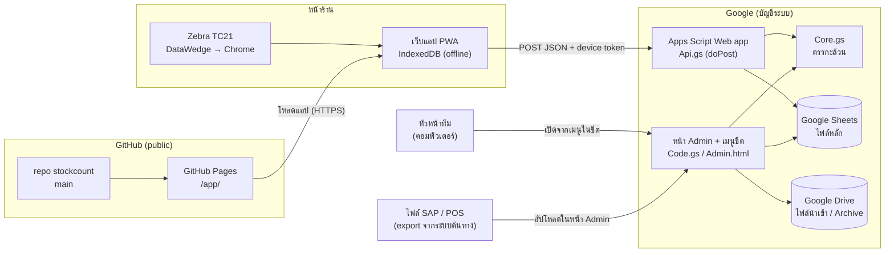

# สถาปัตยกรรมระบบ (v2.2.0)

ระบบตรวจนับสินค้ารายไตรมาสสำหรับร้านค้า 1 สาขา ผู้ตรวจนับใช้เครื่อง Zebra TC21 ยิงบาร์โค้ดผ่านเว็บแอปที่ทำงานได้แม้ไม่มีเน็ต
ข้อมูลทั้งหมดเก็บใน Google Sheets ของบัญชีระบบ หัวหน้าทีมควบคุมรอบนับผ่านหน้า Admin

เอกสารที่เกี่ยวข้อง: [DATA-FLOW.md](DATA-FLOW.md) (เส้นทางข้อมูลและจุดควบคุม) ·
[DATA-DICTIONARY.md](DATA-DICTIONARY.md) (ชีตและคอลัมน์) · [API.md](API.md) (API ของเครื่อง) ·
[DEPLOY-PHASE1.md](DEPLOY-PHASE1.md) / [DEPLOY-PHASE2.md](DEPLOY-PHASE2.md) (ติดตั้งและ Deploy) · [../CHANGELOG.md](../CHANGELOG.md)

## Tech stack

| ชั้น | เทคโนโลยี | หมายเหตุ |
|---|---|---|
| เครื่องนับ | Zebra TC21 (Android 10) + Chrome | สแกนผ่าน DataWedge profile "StockCount" ส่งเป็นการกดแป้น + Enter |
| แอปบนเครื่อง | PWA: HTML + JavaScript (ES5) + CSS ไม่มี framework ไม่มีขั้นตอน build | ติดตั้งเป็นไอคอนบนหน้าจอ ทำงานออฟไลน์ |
| ที่เก็บในเครื่อง | IndexedDB (`kv`, `master`, `entries`, `events`) | บันทึกก่อนมีเสียง/จอเขียวทุกครั้ง |
| แคชแอป | Service Worker แบบ network-first (รอเน็ต 3 วินาที / ไฟล์ประกอบ 1.5 วินาที แล้วใช้สำเนา) | อัปเดตแอปได้เองเมื่อมีเน็ต |
| โฮสต์แอป | GitHub Pages จาก repo สาขา `main` (โฟลเดอร์ `app/`) | ไฟล์ static ล้วน ไม่มีข้อมูลในตัว |
| เซิร์ฟเวอร์ | Google Apps Script (V8) ผูกกับไฟล์ Sheets หลัก | Web app = API ของเครื่อง · เมนูในชีต + หน้า Admin = งานหัวหน้าทีม |
| ฐานข้อมูล | Google Sheets (ไฟล์หลัก 1 ไฟล์ ~20 ชีต) | ตารางแบบ append-only สำหรับข้อมูลนับ |
| ไฟล์ | Google Drive (โฟลเดอร์ `<ชื่อไฟล์>_Files`) | ไฟล์ SAP/POS ที่อัปโหลด และ Archive |
| ไลบรารีภายนอก | SheetJS 0.18.5 (หน้า Admin, export .xlsx) | โหลดจาก CDN jsdelivr |
| ทดสอบ | Node.js (จำลอง Apps Script) + Playwright/Chrome (E2E) | ดู README.md หัวข้อทดสอบ |

## แผนภาพสถาปัตยกรรม

## ส่วนประกอบ

### แอปบนเครื่อง (`app/`)
| ไฟล์ | หน้าที่ |
|---|---|
| `index.html` | โครงหน้าจอ: ตั้งค่า/จับคู่, ตรวจความพร้อม, หน้านับ, ดู/แก้ Location, Location ที่นับแล้ว, ป้อนเอง, สถานะ/Export |
| `app.js` | ตรรกะทั้งหมดของแอป: รับสแกน, บันทึก, ซิงก์, บทบาทผู้ดูแล/ผู้ช่วย, ตรวจความพร้อม, Export |
| `db.js` | IndexedDB และการออกเลข Seq แบบ atomic |
| `sw.js` | Service Worker (แคช + network-first) |
| `style.css` | หน้าจอ 360×568 แนวตั้ง ไม่ลดขนาดแป้นตัวเลข |
| `config.json` | URL ของ API และเวอร์ชันล่าสุดของแอป |
| `labels.html` + `code128.js` | พิมพ์ป้าย Location / บัตรผู้ตรวจ / สติกเกอร์เครื่อง (Code 128) |
| `manifest.webmanifest`, `icons/` | ติดตั้งเป็นแอป |

### เซิร์ฟเวอร์ (`gas/`)
| ไฟล์ | หน้าที่ |
|---|---|
| `Core.gs` | ตรรกะล้วนไม่แตะ Google API: อ่านไฟล์ SAP/POS, สร้าง Master, ตรวจความพร้อม, รูปแบบไฟล์ Export — ทดสอบบน Node ได้ |
| `Code.gs` | โครงสร้างชีต, เมนู, หน้า Admin, เปิดรอบ, อัปโหลด, อนุมัติ Master, จัดการเครื่อง, งานหัวหน้าทีม |
| `Api.gs` | Web app สำหรับเครื่อง: จับคู่, ส่ง Master/Stock, รับข้อมูลนับ, สถานะ Location ผู้ดูแล/ผู้ช่วย |
| `Admin.html` | หน้า Admin (เปิดในชีตเท่านั้น จึงใช้ได้เฉพาะผู้มีสิทธิ์แก้ไขไฟล์) |
| `appsscript.json` | ตั้งค่าโปรเจกต์ Apps Script |

## บัญชีและความเป็นเจ้าของ

| สิ่งที่ต้องมี | บัญชี | หมายเหตุ |
|---|---|---|
| ไฟล์ Sheets หลัก, โฟลเดอร์ Drive, Apps Script | บัญชี Google ของระบบ | Web app ทำงานในนามบัญชีนี้ (Execute as: Me) |
| repo และ GitHub Pages | บัญชี GitHub ของระบบ | repo เป็น public — ห้ามใส่ข้อมูลจริง |
| หน้า Admin | ผู้ที่ได้รับสิทธิ์แก้ไขไฟล์ Sheets | หน้า Admin บันทึกอีเมลผู้กดใน Admin_Log |
| เครื่อง TC21 | ไม่ใช้บัญชี Google | ยืนยันตัวด้วย device token จากการจับคู่ |

รายละเอียดว่าใครถือบัญชีไหนและวิธีกู้คืน อยู่ในเอกสารการเข้าถึงและความปลอดภัย (เอกสารภายใน ไม่อยู่ใน repo)

## หลักการออกแบบสำคัญ

1. **Offline-first** — ทุกการยิงบันทึกลง IndexedDB ก่อนมีเสียงหรือจอเขียว แล้วค่อยส่งขึ้นเซิร์ฟเวอร์เป็นชุดเมื่อมีเน็ต
   เน็ตหลุดทั้งร้านก็นับต่อได้ และ Export เป็นไฟล์ไปนำเข้าทีหลังได้
2. **กันซ้ำด้วย Log_ID** — แต่ละรายการมี `Log_ID = <DeviceID>-<Seq 6 หลัก>` ส่งซ้ำกี่ครั้งเซิร์ฟเวอร์ก็รับครั้งเดียว
   Seq ของเครื่องเรียงต่อเนื่อง ช่องว่างของ Seq แสดงว่ามีรายการหาย
3. **ไม่ลบไม่แก้ข้อมูลนับ** — Count_Log มีแต่เพิ่มแถว การแก้ยอดบันทึกเป็นรายการปรับ (`RECOUNT_SET`, `VOID`) อ้างถึงรายการเดิม
4. **ตรวจยอดระหว่างเครื่องกับเซิร์ฟเวอร์** — เมื่อปิด/พัก/ส่งงาน Location เครื่องส่งจำนวนรายการและจำนวนชิ้นของตัวเองไปด้วย
   เซิร์ฟเวอร์ตอบ ตรง / ไม่ตรง / รอข้อมูล
5. **เซิร์ฟเวอร์ตัดสินบทบาท** — Location หนึ่งมีผู้ดูแลหนึ่งเครื่อง เครื่องอื่นเป็นผู้ช่วย ถ้าแก้หรือปิดในสภาพที่ไม่ครบ ระบบติดธง "ต้องตรวจซ้ำ" แทนการทิ้งข้อมูล
6. **Master อนุมัติก่อนใช้** — รายการบาร์โค้ดที่ส่งลงเครื่องต้องผ่านการตรวจความพร้อมและหัวหน้าทีมอนุมัติ (ผูก checksum กับรอบนับ)
7. **ล็อกการเขียน** — ทุกการเขียนฝั่งเซิร์ฟเวอร์ใช้ ScriptLock กันหลายเครื่องเขียนพร้อมกัน
8. **ข้อมูลรอบอื่นไม่ปน** — รายการที่รหัสรอบไม่ตรง หรือส่งมาหลังปิดรอบ ถูกแยกไว้ที่ชีต Quarantine
9. **เวอร์ชันเดียวทั้งระบบ** — Semantic Versioning ใช้เลขเดียวกันทั้งแอปและเซิร์ฟเวอร์ หน้าตรวจความพร้อมห้ามเริ่มนับถ้า MAJOR.MINOR ไม่ตรงกัน

## สภาพแวดล้อม (Environment)

มีสภาพแวดล้อมเดียว (production) ยังไม่มีระบบทดสอบแยก — โน้ตไว้ใน CHANGELOG ว่าจะแยกภายหลัง

| ค่าที่ตั้ง | อยู่ที่ไหน | ใช้ทำอะไร |
|---|---|---|
| `apiUrl`, `appVersion` | `app/config.json` | URL ของ Web app ที่เครื่องเรียก · เวอร์ชันล่าสุดสำหรับเตือนอัปเดต |
| `APP_VERSION` | `app/app.js` | เวอร์ชันของแอปที่ติดตั้งอยู่ |
| `CACHE` | `app/sw.js` | ชื่อแคช เปลี่ยนตามเวอร์ชันเพื่อบังคับโหลดไฟล์ใหม่ |
| `SYSTEM_VERSION`, `SCHEMA_VERSION` | `gas/Code.gs` | เวอร์ชันเซิร์ฟเวอร์ · เวอร์ชันโครงสร้างชีต (อัปเกรดชีตอัตโนมัติ) |
| ชีต `Config` | ไฟล์ Sheets หลัก | รอบนับ สถานะรอบ ข้อมูลการอัปโหลด การอนุมัติ Master URL — ดู DATA-DICTIONARY.md |

ชุดทดสอบใช้ `tests/mock-server.js` จำลอง API บนเครื่องนักพัฒนา ไม่แตะข้อมูลจริง ไฟล์ตัวอย่าง SAP/POS ส่งผ่านตัวแปรสภาพแวดล้อม และไม่ commit
