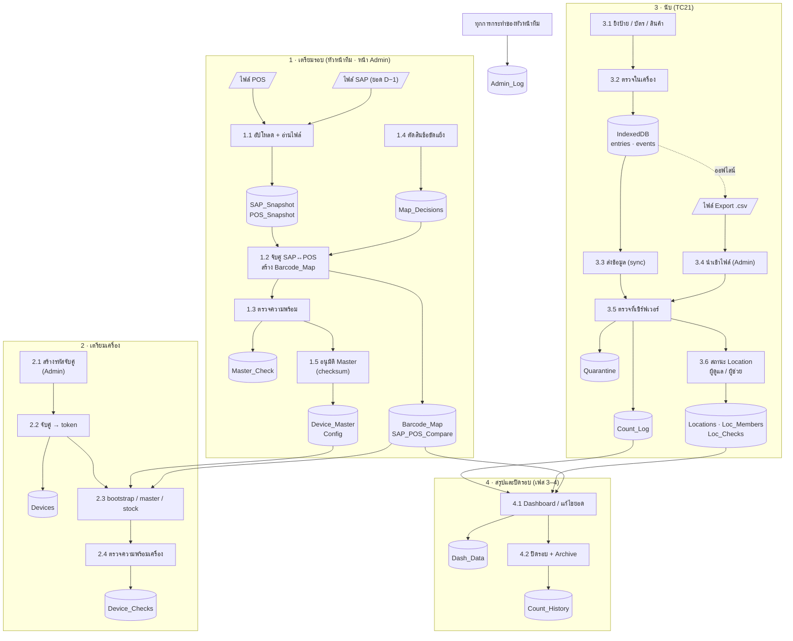

# เส้นทางข้อมูลและจุดควบคุม (v2.2.0)

ข้อมูลเดินเป็น 4 ช่วง: **เตรียมรอบ** (ไฟล์ SAP/POS → Master ที่อนุมัติ) → **เตรียมเครื่อง** (จับคู่ → โหลด Master)
→ **นับ** (ยิง → เครื่อง → เซิร์ฟเวอร์) → **สรุปและปิดรอบ** (เฟส 3–4 ยังไม่ทำ)
ทุกช่วงมีจุดควบคุม (C1–C24) และหลักฐานอยู่ในชีตที่ระบุ ดูความหมายของชีตใน [DATA-DICTIONARY.md](DATA-DICTIONARY.md)

## แผนภาพ (Level 1)

## จุดควบคุม

### 1 · เตรียมรอบ
| # | ความเสี่ยง | Control | หลักฐาน |
|---|---|---|---|
| C1 | ใช้ไฟล์ผิดรอบ / ผิดวัน | ต้องเปิดรอบ (รหัสรอบ + วันนับ) ก่อนอัปโหลด · วันที่ในไฟล์ต้องเป็น D−1 ของวันนับ ไม่ตรง = เตือน | Config, Master_Check |
| C2 | ยอด SAP ยังไม่ปิดบัญชี D−1 | อัปโหลด SAP ต้องติ๊กยืนยัน "บัญชียืนยัน D−1 แล้ว" บันทึกผู้ยืนยัน | Config (SAP_D1_CONFIRMED), Admin_Log |
| C3 | ไฟล์ขาดคอลัมน์ / อ่านผิดรูปแบบ | ตรวจหัวคอลัมน์ที่จำเป็นก่อนรับไฟล์ ไม่ครบ = ปฏิเสธทั้งไฟล์ | ข้อความแจ้งในหน้า Admin |
| C4 | บาร์โค้ดเดียวชี้หลายสินค้า / ข้อมูล SAP ขัดกับ POS | ตรวจความพร้อมแบ่ง 3 ระดับ: ห้ามผ่าน (BLOCK) · เตือน (WARN, ต้องรับทราบ) · แจ้งให้ทราบ (INFO) · ข้อขัดแย้งต้องตัดสินทีละรายการ | Master_Check, Map_Decisions |
| C5 | Master ถูกเปลี่ยนหลังอนุมัติ | อนุมัติผูก checksum ของคู่บาร์โค้ด→สินค้า และรหัสรอบ · checksum เปลี่ยน = ต้องอนุมัติใหม่ · คำเตือนใหม่หลังอนุมัติต้องรับทราบ | Config (MASTER_APPROVED_*), Admin_Log |
| C6 | ล้างข้อมูลรอบโดยไม่ตั้งใจ | เมนูล้างรอบใช้ได้เฉพาะก่อนเริ่มนับ (ยังไม่มีรายการใน Count_Log) | Admin_Log |

### 2 · เตรียมเครื่อง
| # | ความเสี่ยง | Control | หลักฐาน |
|---|---|---|---|
| C7 | เครื่องที่ไม่ได้รับอนุญาตส่งข้อมูล | จับคู่ด้วยรหัส 6 หลัก หมดอายุ 30 นาที ผิด 5 ครั้งรหัสถูกยกเลิก · เก็บเฉพาะ SHA-256 ของ token · ปิดใช้งานเครื่องได้ทันที | Devices, Admin_Log |
| C8 | เครื่องใช้ Master ไม่ตรงที่อนุมัติ | เครื่องตรวจ checksum ของ Master ที่โหลดกับที่อนุมัติ · ไม่ตรง = ตรวจความพร้อมไม่ผ่าน | Device_Checks |
| C9 | เครื่อง/แอปไม่พร้อม (เสียง เวลา เวอร์ชัน) | ตรวจความพร้อมทุกวันก่อนนับ ไม่ผ่าน = เริ่มนับไม่ได้ · แอปกับเซิร์ฟเวอร์ต่าง MAJOR.MINOR = ไม่ผ่าน | Device_Checks, Devices |
| C10 | ไม่รู้ว่าใครนับ | ต้องยิงบัตรผู้ตรวจสอบที่อยู่ในรายชื่อก่อนเริ่ม · ทุกรายการบันทึกรหัสผู้ตรวจ | Count_Log (Staff_Code) |

### 3 · นับ
| # | ความเสี่ยง | Control | หลักฐาน |
|---|---|---|---|
| C11 | ข้อมูลหายเมื่อแอปปิด/เครื่องค้าง | บันทึกลง IndexedDB ก่อนมีเสียงยืนยัน · เปิดใหม่ทำต่อจากเดิม | IndexedDB |
| C12 | ยิงสินค้าโดยไม่มี Location / บาร์โค้ดอ่านผิด | ไม่มี Location = ไม่บันทึก · check digit ผิด = ไม่บันทึก · ไม่รู้จัก = บันทึกแต่เตือนให้แยกสินค้า | Count_Log |
| C13 | กดจำนวนเกิน / ยิงบาร์โค้ดเข้าช่องจำนวน | จำนวนที่ป้อนเองเกิน 150 ต้องยืนยัน · ตัวเลขเกิน 5 หลักไม่บันทึก · เซิร์ฟเวอร์ปฏิเสธเกิน 100,000 | Count_Log |
| C14 | รายการซ้ำเมื่อส่งซ้ำ | Log_ID ไม่ซ้ำ ส่งซ้ำได้ผลเดิม | Count_Log |
| C15 | รายการหายระหว่างทาง | Seq ต่อเนื่องต่อเครื่อง เซิร์ฟเวอร์นับช่องว่าง · เครื่องที่ล้างแล้วจับคู่ใหม่ เริ่ม Seq ต่อจากที่เซิร์ฟเวอร์มี | Devices (Last_Seq, Gaps) |
| C16 | ยอดในเครื่องไม่ตรงเซิร์ฟเวอร์ | ปิด/พัก/ส่งงาน ส่งจำนวนรายการและชิ้นไปเทียบ: ตรง / ไม่ตรง / รอข้อมูล | Loc_Checks, Locations (Last_Check) |
| C17 | ข้อมูลรอบอื่นปนรอบนี้ | รหัสรอบไม่ตรง หรือรอบไม่อยู่ในสถานะรับข้อมูล → แยกไว้ ไม่รวมยอด | Quarantine, Admin_Log |
| C18 | สองเครื่องแก้ยอดชนกัน | แก้ยอด/ล้าง/ปิด ได้เฉพาะผู้ดูแล หลังผู้ช่วยส่งงานครบและข้อมูลถึงครบ · การแก้แนบยอดที่เห็น (Basis) ไม่ตรง = ต้องตรวจซ้ำ | Loc_Members, Count_Log (Basis), Locations (Flag) |
| C19 | ปิด Location ทั้งที่ยังมีคนนับ / มีรายการเข้ามาหลังปิด | ปิดขณะผู้ช่วยยังไม่ส่งงาน หรือยอดตอนปิดไม่ตรง = ต้องตรวจซ้ำ · รายการเกินที่ครอบคลุมตอนปิด = "มีรายการหลังปิด — ตรวจซ้ำ" · ผู้ช่วยยิง Location ที่ปิดแล้วไม่ได้ | Locations (Flag, Close_Cover) |
| C20 | ผู้ช่วยติดต่อไม่ได้ / เครื่องผู้ดูแลเสีย | หัวหน้าทีมส่งงานแทนหรือโอนการดูแลในหน้า Admin เท่านั้น บันทึกผู้กดและเหตุผล | Admin_Log, Loc_Checks |
| C21 | แก้ยอดโดยไม่มีร่องรอย | ไม่แก้แถวเดิม บันทึกรายการปรับพร้อมเหตุผลและยอดก่อน→หลัง | Count_Log (Entry_Type, Reason, Ref_ID) |
| C22 | นำเข้าไฟล์ Export ซ้ำ | ตรวจ checksum ไฟล์ + Log_ID ทีละรายการ แสดง "มีแล้ว n เพิ่มใหม่ m" | Import_Files |

### ทุกช่วง
| # | ความเสี่ยง | Control | หลักฐาน |
|---|---|---|---|
| C23 | ผู้ไม่มีสิทธิ์ใช้หน้า Admin | หน้า Admin เปิดได้จากเมนูในไฟล์ Sheets เท่านั้น (ต้องมีสิทธิ์แก้ไขไฟล์) | สิทธิ์ไฟล์ใน Google Drive |
| C24 | ไม่รู้ว่าใครทำอะไร | ทุกการกระทำของหัวหน้าทีมบันทึกเวลาและอีเมล | Admin_Log |

## จุดที่ยังไม่มี (เฟส 3–5)
- Dashboard สรุปผลนับเทียบยอดบัญชี และการแก้ไขยอดหลังนับ (รวมธง "แก้ยอดเข้าหายอดบัญชี")
- ปิดรอบ (ตาม design ที่ตกลง 10 พ.ย. 2026): ทุกอย่างของรอบจบในรอบนั้น
  1. Export ไฟล์ backup ทั้งรอบ (ทุกชีตงาน: Count_Log, Loc_Checks, Loc_Members, Locations, Device_Master, Quarantine, Admin_Log ฯลฯ) เก็บใน Drive
  2. ล้างชีตงานในไฟล์ที่ใช้งานจริง — รอบถัดไปเริ่มจากศูนย์ (เก็บไว้เฉพาะ Staff, Devices, Config)
  3. Count_History เก็บแค่ **สรุป 1 แถวต่อรอบ** + ลิงก์ไฟล์ backup (ไม่เก็บรายการ)
  4. ดูรอบเก่า: เปิดไฟล์ backup เป็นสำเนาแยก (อ่านอย่างเดียว) — ห้ามโหลดกลับเข้าไฟล์ที่ใช้งานจริง กันข้อมูลสองรอบปนกัน
- ล้างข้อมูลทดสอบก่อนนับจริง
